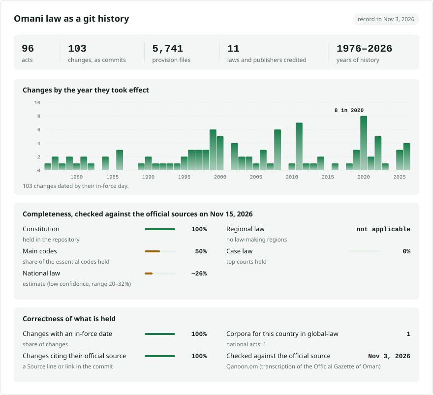

# Oman: law history in git

[العربية](README.md) · **English**

<picture>
<source media="(prefers-color-scheme: dark)" srcset="data/effort-dark.svg">

</picture>

The law of the Sultanate of Oman as a git history: one file per article, one commit per version on the day it took effect, and the royal decree that made each change as the commit's author. `git blame` names the decree behind every paragraph; `git log` lists every change to an article; picking a date gives the text in force that day.

Part of [lexifina/global-law](https://github.com/lexifina/global-law), one git history for every country's law: this is Oman's national law, which global-law reads at `oman/national/acts/`.

**What is in it now:** 96 acts with 103 versions: the Basic Statute of the State (4 versions, 1996 to 2026), the Penal Code (4) and the Personal Data Protection Law (2), each with its dated history; and 93 other laws and royal decrees, each as its current text in one version. [`REPRODUCE.md`](REPRODUCE.md) lists every act; [`data/laws.csv`](data/laws.csv) every decree in the record.

The three acts with a history are in `nizam-asasi/`, `qanun-al-jaza/` and `himayat-al-bayanat/`; the others are in `rd/<year>/<number>/`, after the royal decree that issued them (`rd/1977/26/` is the Commercial Agencies Law, RD 26/77). Each folder holds the law's articles (`art-NNN.md`, `art-NNN-bis.md` for مكررا) and, where the source gives them, the issuing decree's preamble (`preamble.md`) and articles (`isdar-NN.md`); `data/paths.json` maps each act id to its folder.

The text is in Arabic, as Qanoon.om transcribes it from the Official Gazette. An English translation is not part of this record.

## Questions as git commands

| Question | Command |
| --- | --- |
| Every change to Article 86 of the Basic Statute | `git log -p --word-diff -- nizam-asasi/art-086.md` |
| Which decree wrote each line of Article 86? | `git blame nizam-asasi/art-086.md` |
| Every version of the Basic Statute, with the day each took effect | `git log --format="%h %(trailers:key=In-force,valueonly,separator=) %an" -- nizam-asasi ":^nizam-asasi/README.md"` |
| Article 86 as in force on 1 June 2026 | `python tools/on.py 2026-06-01 nizam-asasi art-086` |

**Outside git**, we also host this record publicly, for free:

- **[Ask Claude about Omani law](https://global-law.lexifina.com/v1/try_claude?country=oman)**: opens Claude with a first question ready.
- **[Ask ChatGPT](https://global-law.lexifina.com/v1/try_chatgpt?country=oman)**: the same question in ChatGPT.
- **[Search Omani law on our site](https://lexifina.com/law?country=oman&q=%D8%AD%D8%B1%D9%8A%D8%A9+%D8%A7%D9%84%D8%B1%D8%A3%D9%8A)**: a search for "حرية الرأي" (freedom of opinion), with each provision's text and its versions, no account needed.
- **[Developer REST API](https://global-law.lexifina.com/v1/search_law?query=%D8%AD%D8%B1%D9%8A%D8%A9+%D8%A7%D9%84%D8%B1%D8%A3%D9%8A&jurisdiction=oman)**: the same search as JSON, with no key. See the [documentation here](https://lexifina.com/api/global-law).

Both assistants read the record through the free Global law connector (MCP, `https://global-law.lexifina.com/mcp`); the first time, the chat gives you the link that adds it. Ask in Arabic or in English.

**Host it yourself easily.** All it takes is git and Python, and the tools run on your machine:

```sh
git clone --depth 1 https://github.com/lexifina/global-law && cd global-law
python3 tools/countries.py add oman/national/acts
python3 tools/law.py show 2026-01-01 oman/national/acts/nizam-asasi/art-086.md
```

Opened in Claude Code, Cursor, VS Code or Codex, the clone also starts a local MCP server with the same tools ([MCP.md](https://github.com/lexifina/global-law/blob/main/MCP.md)).

## Dates

Each commit is dated at noon, Asia/Muscat, on the day the version took effect, and carries it in its `In-force:` trailer; the three acts' commits also carry the decree's issue and Gazette days (`Enacted:`, `Published:`).

- For the three acts with a history, the day each decree fixes in its last article: from its issue (RD 101/96, RD 6/2021, RD 79/2026), from the day after its publication (RD 99/2011, RD 7/2018, RD 68/2022, RD 11/2025, RD 66/2026, RD 68/2026), or one year after it (RD 6/2022). Without such a day, laws take effect on publication (Basic Statute of 2021, art. 91).
- The statutes of 1996 and 2021 are one act in `nizam-asasi/`: RD 6/2021 repealed the first, so on 11 January 2021 every article is rewritten and the 1996 articles the new statute lacks are removed.
- The other 93 acts are dated by the in-force day of the decree that issued them, although their text is today's. Fourteen of those decrees defer their start by months or years (the Labour Law of 2003 by a month) and are still dated on the day of publication.

The three acts' changes are credited to the decree that made them (`rd-2022-68@qanoon.invalid`), as Qanoon.om's footnotes name it or, for RD 99/2011, which no page footnotes, from the decree's own text. The 93 one-version acts are credited to the publisher, Qanoon.om, as the "oldest version available", with the issuing decree named in the commit message. The committer is Lexifina.

## How it is checked

- The three acts are rebuilt from each decree as issued; their last version must equal Qanoon.om's consolidated page, and every line an amendment adds must appear in that decree.
- The Ministry of Justice and Legal Affairs' PDFs have a scrambled text layer, so the letters of each article are matched with them instead (alef forms and digits left out). Every article of the three acts matched on 29 October 2026; of the 93 others, 13 match in every article, 46 in part (3,239 of the 59 acts' 3,590 articles match) and 34 have no Ministry PDF. The result per act is in [`REPRODUCE.md`](REPRODUCE.md).
- `tools/check_repo.py` reads every version back from git on the day it took effect and on the day before and compares it with the corpus; `tools/build.py` gives the same commit hashes from the same corpus. `REPRODUCE.md` records that neither was run for the latest build.
- History grows append-only: `tools/append.py` puts new acts and versions on top and stops rather than rewrite a published commit.
- [vulnerabilities/](vulnerabilities/README.en.md): possible drafting mistakes in Omani law, found by global-law's detectors and checked by hand.

## What it does not show

- **The history of the 93 other acts.** Their text as issued and each amending decree are not yet commits, so a date before today can show wording that came later.
- **Repeals.** A repealed act is not marked: the Labour Law of 2003 (RD 35/2003) is here, though the Labour Law of 2023 (RD 53/2023) repealed it; the 2023 law is one of eight left out as open problems (see `REPRODUCE.md`).
- **Headings and signature blocks.** Book, part and chapter headings are not files, so two heading changes in the Penal Code are not commits; the decrees' signature blocks (date, signature, Gazette issue) are left out of the text.
- **Other legislation.** Ministerial decisions, regulations outside Qanoon.om's consolidated laws, treaties and case law are not here, nor is the Penal Law of 1974 (RD 7/74).
- **Applicability.** Transitional rules are in the text, not in the dates.

## Sources

| Source | Kind | Past versions | Notes |
| --- | --- | --- | --- |
| [Qanoon.om](https://qanoon.om) | Transcription of the Official Gazette | each decree as issued, and a consolidated page per law | Used for the text; footnotes name the amending decree. It states it is not an official source |
| [Ministry of Justice and Legal Affairs](https://mjla.gov.om) | Official legislation, PDF per law | current text only | Used for the letter check |

## Licence

See [`LICENSE`](LICENSE). Qanoon.om states that texts of law are public property in Oman under the Copyright and Related Rights Law and may be used, copied, published and translated freely; the Ministry's site is under the Government Open Licence - Sultanate of Oman. Lexifina's history, commit messages, tables and tools are CC0 1.0.

No AI model wrote, translated or corrected legal text, and none runs when the history is built; the scripts were written by an AI model (see [`REPRODUCE.md`](REPRODUCE.md)).

## More

From [lexifina/global-law](https://github.com/lexifina/global-law):

- [FEATURES.md](https://github.com/lexifina/global-law/blob/main/FEATURES.md): every feature, and what every corpus must support (`git blame`, `law.py`, the MCP tools)
- [FAQ.md](https://github.com/lexifina/global-law/blob/main/FAQ.md): questions and answers · [CONTRIBUTING.md](https://github.com/lexifina/global-law/blob/main/CONTRIBUTING.md): proposing changes · [MCP.md](https://github.com/lexifina/global-law/blob/main/MCP.md): the MCP server · [REPRODUCE.md](https://github.com/lexifina/global-law/blob/main/REPRODUCE.md): how it was built · [CHANGELOG.md](https://github.com/lexifina/global-law/blob/main/CHANGELOG.md)
- [FRESHNESS.md](https://github.com/lexifina/global-law/blob/main/FRESHNESS.md): how current each corpus is · [Monitoring](https://github.com/lexifina/global-law/tree/main/monitoring): whether updates are running · [WATCHING.md](https://github.com/lexifina/global-law/blob/main/WATCHING.md): how each official source is watched for changes
- [performance/](https://github.com/lexifina/global-law/tree/main/performance): how fast the tools are, measured
- [visualisations/](https://github.com/lexifina/global-law/tree/main/visualisations): charts and bridges across the world's law
- [Vulnerabilities](https://github.com/lexifina/global-law/tree/main/vulnerabilities): mistakes in legislation as published
