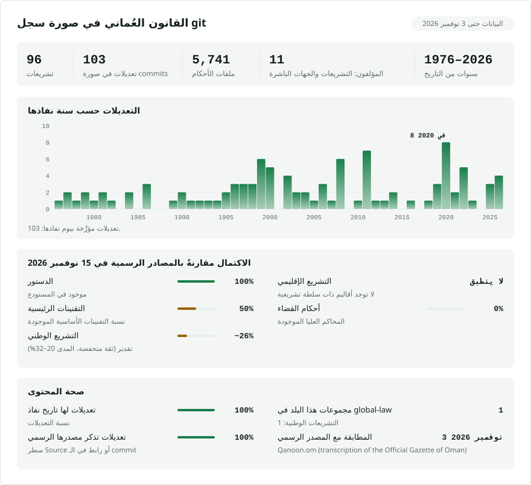

# عُمان: تاريخ القانون في git

**العربية** · [English](README.en.md)

<picture>
<source media="(prefers-color-scheme: dark)" srcset="data/ar/effort-dark.svg">

</picture>

قانون سلطنة عُمان في صورة سجل git: ملف لكل مادة، ولكل نسخة commit واحد في يوم العمل بها، والمرسوم السلطاني الذي أجرى كل تعديل هو مؤلف الـ commit. يبيّن `git blame` المرسوم الذي يقف وراء كل فقرة؛ ويسرد `git log` كل تعديل طرأ على مادة؛ واختيار تاريخ ما يعطي النص النافذ في ذلك اليوم.

جزء من [lexifina/global-law](https://github.com/lexifina/global-law)، وهو سجل git واحد لقانون كل بلد: هذا هو القانون الوطني العُماني، الذي يقرؤه global-law في `oman/national/acts/`.

**المحتوى الحالي:** 96 تشريعًا في 103 نسخ: النظام الأساسي للدولة (4 نسخ، من 1996 إلى 2026)، وقانون الجزاء (4) وقانون حماية البيانات الشخصية (2)، كل منها بتاريخ تعديلاته مؤرَّخًا؛ و93 قانونًا ومرسومًا سلطانيًا آخر، كل منها بنصه الحالي في نسخة واحدة. يسرد [`REPRODUCE.md`](REPRODUCE.md) كل تشريع؛ ويسرد [`data/laws.csv`](data/laws.csv) كل مرسوم في السجل.

التشريعات الثلاثة ذات التاريخ موجودة في `nizam-asasi/` و`qanun-al-jaza/` و`himayat-al-bayanat/`؛ أما البقية ففي `rd/<year>/<number>/`، بحسب المرسوم السلطاني الذي أصدرها (`rd/1977/26/` هو قانون الوكالات التجارية، المرسوم السلطاني 26/77). يضم كل مجلد مواد القانون (`art-NNN.md`، و`art-NNN-bis.md` للمواد المكررة "مكررا") وكذلك، حيث يوردها المصدر، ديباجة مرسوم الإصدار (`preamble.md`) ومواده (`isdar-NN.md`)؛ ويربط `data/paths.json` معرّف كل تشريع بمجلده.

النص باللغة العربية، كما ينقله موقع Qanoon.om عن الجريدة الرسمية. والترجمة الإنجليزية ليست جزءًا من هذا السجل.

## الأسئلة في صورة أوامر git

| السؤال | الأمر |
| --- | --- |
| كل تعديل طرأ على المادة 86 من النظام الأساسي | `git log -p --word-diff -- nizam-asasi/art-086.md` |
| أي مرسوم كتب كل سطر من المادة 86؟ | `git blame nizam-asasi/art-086.md` |
| كل نسخ النظام الأساسي، مع يوم العمل بكل منها | `git log --format="%h %(trailers:key=In-force,valueonly,separator=) %an" -- nizam-asasi ":^nizam-asasi/README.md"` |
| المادة 86 كما كانت نافذة في 1 يونيو 2026 | `python tools/on.py 2026-06-01 nizam-asasi art-086` |

**خارج git**، نستضيف هذا السجل أيضًا للعموم، مجانًا:

- **[اسأل Claude عن القانون العُماني](https://global-law.lexifina.com/v1/try_claude?country=oman)**: يفتح Claude ومعه سؤال أول جاهز.
- **[اسأل ChatGPT](https://global-law.lexifina.com/v1/try_chatgpt?country=oman)**: السؤال نفسه في ChatGPT.
- **[ابحث في القانون العُماني على موقعنا](https://lexifina.com/law?country=oman&q=%D8%AD%D8%B1%D9%8A%D8%A9+%D8%A7%D9%84%D8%B1%D8%A3%D9%8A)**: بحث عن "حرية الرأي"، مع نص كل حكم ونسخه، دون الحاجة إلى حساب.
- **[واجهة REST API للمطوّرين](https://global-law.lexifina.com/v1/search_law?query=%D8%AD%D8%B1%D9%8A%D8%A9+%D8%A7%D9%84%D8%B1%D8%A3%D9%8A&jurisdiction=oman)**: البحث نفسه بصيغة JSON، دون مفتاح. انظر [التوثيق هنا](https://lexifina.com/api/global-law).

يقرأ المساعدان كلاهما السجل عبر موصِّل Global law المجاني (MCP، `https://global-law.lexifina.com/mcp`)؛ وفي المرة الأولى تعطيك المحادثة الرابط الذي يضيفه. اسأل بالعربية أو بالإنجليزية.

**استضفه بنفسك بسهولة.** كل ما يلزم هو git وPython، والأدوات تعمل على جهازك:

```sh
git clone --depth 1 https://github.com/lexifina/global-law && cd global-law
python3 tools/countries.py add oman/national/acts
python3 tools/law.py show 2026-01-01 oman/national/acts/nizam-asasi/art-086.md
```

عند فتح النسخة المستنسخة في Claude Code أو Cursor أو VS Code أو Codex، تشغّل أيضًا خادم MCP محليًا بالأدوات نفسها ([MCP.md](https://github.com/lexifina/global-law/blob/main/MCP.md)).

## التواريخ

يحمل كل commit تاريخ الظهيرة، بتوقيت Asia/Muscat، من اليوم الذي بدأ فيه العمل بالنسخة، ويحمل هذا اليوم في تذييله (trailer) `In-force:`؛ وتحمل commits التشريعات الثلاثة أيضًا يومَي إصدار المرسوم ونشره في الجريدة الرسمية (`Enacted:`، `Published:`).

- في التشريعات الثلاثة ذات التاريخ، اليوم الذي يحدده كل مرسوم في مادته الأخيرة: من تاريخ صدوره (المراسيم السلطانية 101/96 و6/2021 و79/2026)، أو من اليوم التالي لتاريخ نشره (المراسيم السلطانية 99/2011 و7/2018 و68/2022 و11/2025 و66/2026 و68/2026)، أو بعد سنة من تاريخ نشره (المرسوم السلطاني 6/2022). وعند عدم تحديد مثل هذا اليوم، يُعمل بالقوانين من تاريخ نشرها (النظام الأساسي لسنة 2021، المادة 91).
- النظامان الأساسيان لسنتي 1996 و2021 تشريع واحد في `nizam-asasi/`: فقد ألغى المرسوم السلطاني 6/2021 الأول، لذا تُعاد كتابة كل مادة في 11 يناير 2021 وتُحذف مواد 1996 التي لا يتضمنها النظام الجديد.
- تُؤرَّخ التشريعات الـ 93 الأخرى بيوم العمل بالمرسوم الذي أصدرها، رغم أن نصها هو النص الحالي. ويؤجّل أربعة عشر من هذه المراسيم بدء العمل بها أشهرًا أو سنوات (قانون العمل لسنة 2003 بشهر واحد) ومع ذلك تُؤرَّخ بيوم النشر.

تُنسب تعديلات التشريعات الثلاثة إلى المرسوم الذي أجراها (`rd-2022-68@qanoon.invalid`)، كما تسمّيه حواشي موقع Qanoon.om، أو، في حالة المرسوم السلطاني 99/2011 الذي لا تذكره أي حاشية في الصفحات، استنادًا إلى نص المرسوم نفسه. وتُنسب التشريعات الـ 93 ذات النسخة الواحدة إلى الجهة الناشرة، Qanoon.om، بوصفها "أقدم نسخة متاحة"، مع ذكر مرسوم الإصدار في رسالة الـ commit. والمُودِع (committer) هو Lexifina.

## كيف يُتحقَّق منه

- يُعاد بناء التشريعات الثلاثة من كل مرسوم كما صدر؛ ويجب أن تطابق نسختها الأخيرة الصفحة الموحَّدة في موقع Qanoon.om، وأن يرد كل سطر يضيفه تعديلٌ ما في ذلك المرسوم.
- الطبقة النصية في ملفات PDF الصادرة عن وزارة العدل والشؤون القانونية مشوَّشة، لذا تُطابَق حروف كل مادة معها بدلًا من ذلك (مع استبعاد صور الألف والأرقام). تطابقت كل مواد التشريعات الثلاثة في 29 أكتوبر 2026؛ ومن التشريعات الـ 93 الأخرى، تتطابق 13 في كل موادها، و46 جزئيًا (تتطابق 3239 مادة من أصل 3590 مادة في هذه التشريعات الـ 59) و34 ليس لها ملف PDF لدى الوزارة. والنتيجة لكل تشريع في [`REPRODUCE.md`](REPRODUCE.md).
- يعيد `tools/check_repo.py` قراءة كل نسخة من git في يوم العمل بها وفي اليوم السابق له، ويقارنها بالمجموعة؛ ويعطي `tools/build.py` بصمات الـ commits نفسها من المجموعة نفسها. ويسجّل `REPRODUCE.md` أن أيًا منهما لم يُشغَّل لآخر عملية بناء.
- ينمو السجل بالإضافة فقط: يضع `tools/append.py` التشريعات والنسخ الجديدة فوق ما سبق، ويتوقف بدلًا من إعادة كتابة commit منشور.

## ما لا يُظهره

- **تاريخ التشريعات الـ 93 الأخرى.** نصها كما صدر وكل مرسوم معدِّل لها ليسا commits بعد، لذا قد يُظهر تاريخ سابق لليوم صياغةً جاءت لاحقًا.
- **الإلغاءات.** لا يُشار إلى التشريع الملغى: فقانون العمل لسنة 2003 (المرسوم السلطاني 35/2003) موجود هنا، رغم أن قانون العمل لسنة 2023 (المرسوم السلطاني 53/2023) ألغاه؛ وقانون 2023 واحد من ثمانية تشريعات استُبعدت بوصفها مشكلات مفتوحة (انظر `REPRODUCE.md`).
- **العناوين وكتل التوقيع.** عناوين الكتب والأبواب والفصول ليست ملفات، لذا فإن تعديلين في العناوين في قانون الجزاء ليسا commits؛ وتُستبعد من النص كتل التوقيع في المراسيم (التاريخ والتوقيع وعدد الجريدة الرسمية).
- **التشريعات الأخرى.** القرارات الوزارية، واللوائح غير الواردة في القوانين الموحَّدة على موقع Qanoon.om، والمعاهدات، والأحكام القضائية غير موجودة هنا، ولا قانون الجزاء لسنة 1974 (المرسوم السلطاني 7/74).
- **نطاق التطبيق.** القواعد الانتقالية واردة في النص، لا في التواريخ.

## المصادر

| المصدر | النوع | النسخ السابقة | ملاحظات |
| --- | --- | --- | --- |
| [Qanoon.om](https://qanoon.om) | نقل عن الجريدة الرسمية | كل مرسوم كما صدر، وصفحة موحَّدة لكل قانون | يُستخدم للنص؛ وتسمّي الحواشي المرسوم المعدِّل. ويذكر الموقع أنه ليس مصدرًا رسميًا |
| [وزارة العدل والشؤون القانونية](https://mjla.gov.om) | التشريعات الرسمية، ملف PDF لكل قانون | النص الحالي فقط | يُستخدم لمطابقة الحروف |

## الترخيص

انظر [`LICENSE`](LICENSE). يذكر موقع Qanoon.om أن نصوص القوانين ملك عام في عُمان بموجب قانون حقوق المؤلف والحقوق المجاورة، ويجوز استخدامها ونسخها ونشرها وترجمتها بحرية؛ وموقع الوزارة خاضع للترخيص الحكومي المفتوح (Government Open Licence - Sultanate of Oman). أما سجل Lexifina ورسائل الـ commits والجداول والأدوات فهي بموجب CC0 1.0.

لم يكتب أي نموذج ذكاء اصطناعي نصًا قانونيًا ولم يترجمه ولم يصححه، ولا يعمل أي نموذج عند بناء السجل؛ أما البرامج النصية (scripts) فكتبها نموذج ذكاء اصطناعي (انظر [`REPRODUCE.md`](REPRODUCE.md)).

هذا النص ترجمة للنسخة الإنجليزية ([README.en.md](README.en.md))؛ وعند الاختلاف تسود النسخة الإنجليزية.

## المزيد

من مستودع [lexifina/global-law](https://github.com/lexifina/global-law) (صفحات باللغة الإنجليزية):

- [FEATURES.md](https://github.com/lexifina/global-law/blob/main/FEATURES.md): جميع الميزات، وما يجب أن تدعمه كل مجموعة (`git blame`، `law.py`، أدوات MCP)
- [FAQ.md](https://github.com/lexifina/global-law/blob/main/FAQ.md): أسئلة وأجوبة · [CONTRIBUTING.md](https://github.com/lexifina/global-law/blob/main/CONTRIBUTING.md): اقتراح تغييرات · [MCP.md](https://github.com/lexifina/global-law/blob/main/MCP.md): خادم MCP · [REPRODUCE.md](https://github.com/lexifina/global-law/blob/main/REPRODUCE.md): طريقة البناء · [CHANGELOG.md](https://github.com/lexifina/global-law/blob/main/CHANGELOG.md)
- [FRESHNESS.md](https://github.com/lexifina/global-law/blob/main/FRESHNESS.md): مدى حداثة كل مجموعة · [المراقبة](https://github.com/lexifina/global-law/tree/main/monitoring): هل تعمل التحديثات · [WATCHING.md](https://github.com/lexifina/global-law/blob/main/WATCHING.md): كيف يُراقَب كل مصدر رسمي لرصد التغييرات
- [performance/](https://github.com/lexifina/global-law/tree/main/performance): سرعة الأدوات كما قيست
- [visualisations/](https://github.com/lexifina/global-law/tree/main/visualisations): رسوم بيانية وروابط عبر قوانين العالم
- [الثغرات](https://github.com/lexifina/global-law/tree/main/vulnerabilities): أخطاء في التشريعات كما نُشرت
