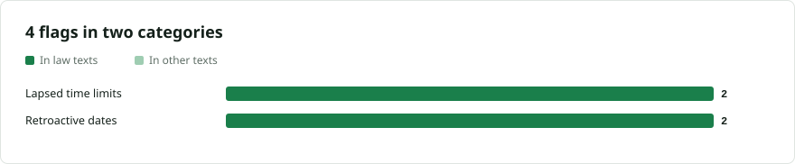

# Vulnerabilities in Omani law

[العربية](README.md) · **English**

<picture>
<source media="(prefers-color-scheme: dark)" srcset="img/flags-by-category-dark.svg">

</picture>

The vulnerability detectors from [lexifina/global-law](https://github.com/lexifina/global-law/tree/main/vulnerabilities) look for mechanical mistakes in legislation: a rule applying "until" a date that has passed, a provision repealed before its replacement took effect, two amendments to the same provision on the same day, a reference to an article that no longer exists. global-law's published list (9 November 2026) had no flags for Oman, so this is a run over this repository only, as it stood at commit [`d174cb5`](https://github.com/lexifina/oman-law/commit/d174cb51eda4bbc05c44b97c7f29e572e6fa57fa) on 16 November 2026: the Basic Statute of the State, the Penal Code, the Personal Data Protection Law and 93 other laws and royal decrees, in Arabic, as Qanoon.om transcribes them from the Official Gazette. The detectors did not read Arabic dates until they were fixed for this run (below).

**In short:** the detectors raised 4 flags: two lapsed time limits and two retroactive dates. A language model reviewed all four, arguing each one for and against; none survived. Checked by hand, none is a mistake: one date is a deadline for a one-off obligation in a telecommunications licence, one closes a band of contribution rates whose next band follows, and the two royal decrees dated before their publication each say they take effect from the date they were issued. Reading the references by hand turned up one likely drafting mistake the detectors could not see: Article 159 bis (21) of the Income Tax Law (Royal Decree 28/2009) still applies Article 135 bis, which Royal Decree 118/2020 repealed when it put the same rule, the amended income return, in a new Article 138; the same decree replaced Article 159 bis (17) and left Article 159 bis (21) as it was. It also turned up one problem in this repository, listed below. Later, this will be formalised in Lean, similar to our work on [the US tax code](https://lexifina.com/blog/formalizing-the-us-tax-code) and [US case law](https://lexifina.com/blog/formalizing-all-us-case-law-in-lean).

A flag is a prompt to look, not legal advice, and nothing here has been tested in court.

## Flags by category

| Category | What it looks for | Flags | In law texts | Reviewed | Survived review |
| --- | --- | ---: | ---: | ---: | ---: |
| Lapsed time limits | Text still applying a rule "until" a date that has passed | 2 | 2 | 2 | 0 |
| Retroactive or pre-publication dates | A law dated in force before it was published | 2 | 2 | 2 | 0 |

"In law texts" counts all the law this repository holds: the Basic Statute (`nizam-asasi/`), the Penal Code (`qanun-al-jaza/`), the Personal Data Protection Law (`himayat-al-bayanat/`) and the other 93 acts (`rd/<year>/<number>/`), one file per article. The other files are the READMEs, the root files (the licence, `REPRODUCE.md`, `jurisdiction.json`), `data/` and `tools/`; none has a flag. The history detectors have little to read: the 93 acts under `rd/` are each held in one version, their current text, credited to the publisher, so their text never changes in the history. Only the three acts with a dated history have changes credited to the royal decrees that made them (10 commits, among them each act's first text). The search for repeal gaps, same-day conflicts, empty periods, stale amounts and references to deleted provisions found nothing. The time-limit search reads "حتى" or "لغاية" (until) before a date and "قبل نهاية سنة" (before the end of the year) before a year, in Arabic-Indic or Western digits: the law texts hold one of each, both flagged ("حتى ١ / ١١ / ١٩٩٦م" and "قبل نهاية سنة ٢٠٢٤م"); it leaves out one "until" that gives only a month ("حتى شهر يونيو ١٩٨٦م"), as it does in other languages. No date in the law texts is written in the Hijri calendar.

*Edge cases: what the 4 flags are, checked by hand, and the reference to a repealed article that the detectors could not see, in [EDGE-CASES.en.md](EDGE-CASES.en.md).*

## Problems found in this repository

- **Article 29 of the Documents and Archives Law in Article 28's file:** in [`rd/2007/60/art-028.md`](https://github.com/lexifina/oman-law/blob/d174cb51eda4bbc05c44b97c7f29e572e6fa57fa/rd/2007/60/art-028.md) (Royal Decree 60/2007), Article 28 is followed by a line reading "المادة (٢٩)" and the whole of Article 29 (the exceptions to Articles 26 to 28 on access to archives). There is no `art-029.md`, so the act's README lists no Article 29 and its history cannot be asked for on its own. No other article file in this repository holds another article's heading.

## Files

| File | What it holds |
| --- | --- |
| [data/flags.csv](data/flags.csv) | Every flag, one row per provision and issue |
| [data/reviewed.csv](data/reviewed.csv) | The 4 flags the model reviewed, with its verdict and reason |
| [data/by_category.csv](data/by_category.csv) | The counts in the table above |
| [tools/](tools/) | The scripts that made this run |

Columns: `category` and `category_ar` (the category in English and Arabic), `detector`, `kind` (`law` or `other`), `path` (the article in this repository), `date` (the date the flag turns on), `reference` (the decree involved; for a lapsed time limit, the publisher the version is credited to), `summary`, `score` (the detector's ranking, 0 to 1), `review` (`artefact`, `lawful` or `candidate_defect`), `survives_rebuttal`, `review_note` (the model's reason, in English), `url` (the article at the commit that was read; for a retroactive date, the decree's commit).

## How it was made

- **Detectors:** global-law's [vulnerabilities/scripts](https://github.com/lexifina/global-law/tree/main/vulnerabilities/scripts), with the fixes in [tools/](tools/README.md) (among them `patch_ar.py`, which teaches the time-limit search Arabic "until" and the amount search rials and baisas), run on this repository at commit `d174cb5`. The history table the detectors read was built from this repository's own commits (the decree or publisher each version is credited to, and the `In-force` and `Kind` trailers): the 10 commits of kind `decree` and the 93 of kind `publisher` count as changes to the law. Paths from before the folder move of 10 November 2026 are mapped to each act's folder today through `data/paths.json`. The corpus language is Arabic.
- **Model review:** gpt-5.4-mini, the 40 strongest flags per category, which here meant all 4; one pass says whether a flag is real, a second argues that it is not. There were no empty periods to review.
- **Hand check:** every flag was read in this repository's text and history, and every reference in the law texts to a numbered article of the same act was checked against the articles this repository holds. Royal Decrees 9/2017, 118/2020 and 79/2026 are not in this repository: their wording was read on Qanoon.om, as were the Income Tax Law's notes on Article 135 bis. None of this was compared with the Official Gazette.

To report a correction, open an issue with the provision and an official source.

## Licence

The lists and notes are Lexifina's, dedicated to the public domain under CC0 1.0, like the rest of this repository's own contributions. Quoted law text is as Qanoon.om transcribes it from the Official Gazette; Qanoon.om states that the texts of law are public property in Oman under the Copyright and Related Rights Law and may be used, copied, published and translated freely. See [LICENSE](../LICENSE).
